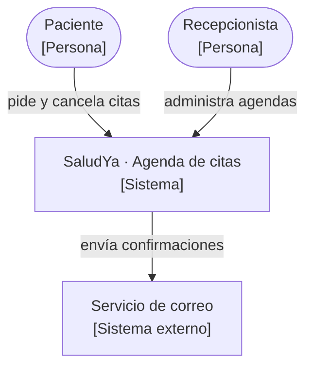
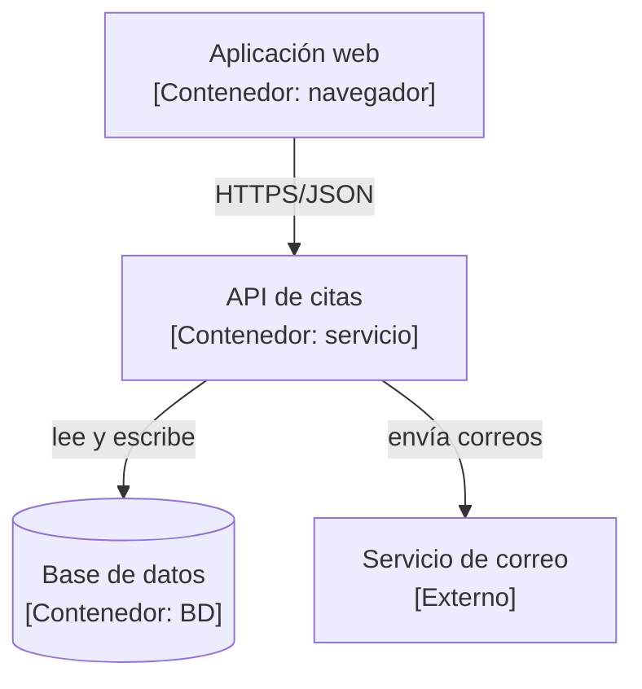

# Diagramas C4 en Mermaid (plantilla)

GitHub dibuja estos bloques directamente en cualquier `.md`. Cambia los nombres por los de tu sistema.

## Nivel 1 · Contexto: quién usa el sistema y con qué otros sistemas habla

## Nivel 2 · Contenedores: las piezas que se despliegan

Cada flecha lleva un verbo y, si importa, la tecnología. Si dos cajas hacen lo mismo, probablemente sobra una.
